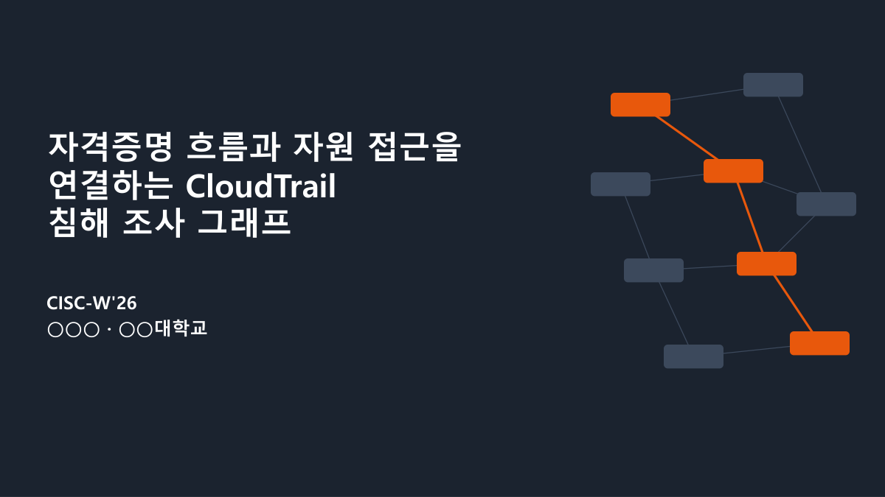

# 자격증명 흐름과 자원 접근을 연결하는 CloudTrail 침해 조사 그래프

2026년 한국정보보호학회 동계학술대회 CISC-W’26 / 구두발표

저자: 강인석, 서장훈, 정준식, 박기웅

## 연구 내용

발급된 자격증명과 후속 호출, 자원 접근을 연결해 CloudTrail의 흩어진 기록을 조사 경로로 재구성합니다.

## 자료

- [논문 원문 (PDF)](paper.pdf)
- [학회 발표 자료 (PDF)](presentation.pdf)
- [구현 저장소](https://github.com/ICT-Zero-Cloud/cloud-attack-path-visualization)

## 자료 안내

논문 원문은 제공된 파일 그대로 수록합니다. 학회 발표 자료는 PDF로 제공하며, PowerPoint 원본으로 받은 자료는 PDF로 변환합니다. 구현 저장소에는 논문 작성 이후의 개발 내용이 포함될 수 있습니다.

[전체 연구와 활동 기록으로 돌아가기](../../README.md)
