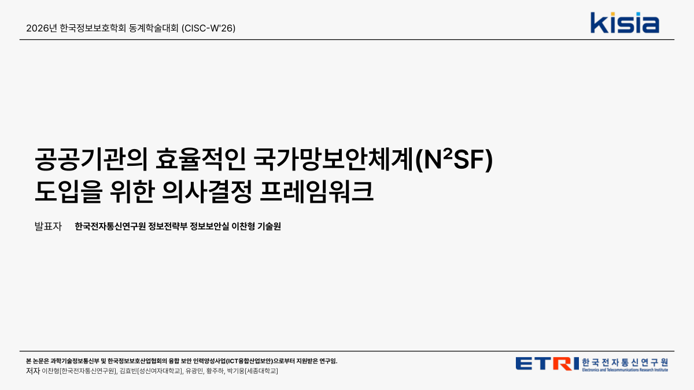

# 공공기관의 효율적인 국가망보안체계(N²SF) 도입을 위한 의사결정 프레임워크

2026년 한국정보보호학회 동계학술대회 CISC-W’26 / 구두발표

저자: 이찬형, 김효빈, 유광민, 황주하, 박기웅

수상: 2026.10.29 행정안전부 장관상

## 연구 내용

기존 보안통제의 구현과 운영 상태를 검증하고, 보완 대안을 예산과 인력 여건에 따라 비교과 선택하는 절차를 제안합니다.

## 자료

- [논문 원문 (PDF)](paper.pdf)
- [학회 발표 자료 (PDF)](presentation.pdf)

## 자료 안내

논문 원문은 제공된 파일 그대로 수록합니다. 학회 발표 자료는 PDF로 제공하며, PowerPoint 원본으로 받은 자료는 PDF로 변환합니다. 구현 저장소에는 논문 작성 이후의 개발 내용이 포함될 수 있습니다.

[전체 연구와 활동 기록으로 돌아가기](../../README.md)
