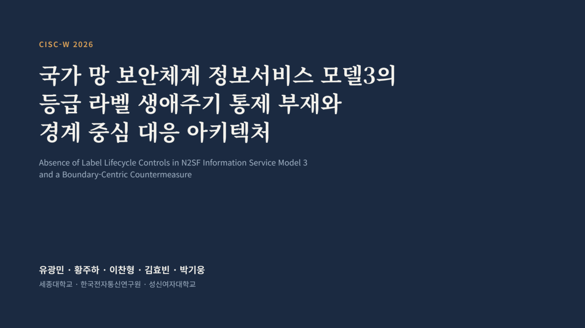

# 국가 망 보안체계 정보서비스 모델3의 등급 라벨 생애주기 통제 부재와 경계 중심 대응 아키텍처

2026년 한국정보보호학회 동계학술대회 CISC-W’26 / 구두발표

저자: 유광민, 황주하, 이찬형, 김효빈, 박기웅

수상: 2026.10.29 한국정보보호학회장상

## 연구 내용

정보의 이동과 변경 과정에서 발생하는 등급 라벨의 공백을 분석하고, 경계 통제점과 등급 원장을 활용하는 대응 구조를 제안합니다.

## 자료

- [논문 원문 (PDF)](paper.pdf)
- [학회 발표 자료 (PDF)](presentation.pdf)

## 자료 안내

논문 원문은 제공된 파일 그대로 수록합니다. 학회 발표 자료는 PDF로 제공하며, PowerPoint 원본으로 받은 자료는 PDF로 변환합니다. 구현 저장소에는 논문 작성 이후의 개발 내용이 포함될 수 있습니다.

[전체 연구와 활동 기록으로 돌아가기](../../README.md)
