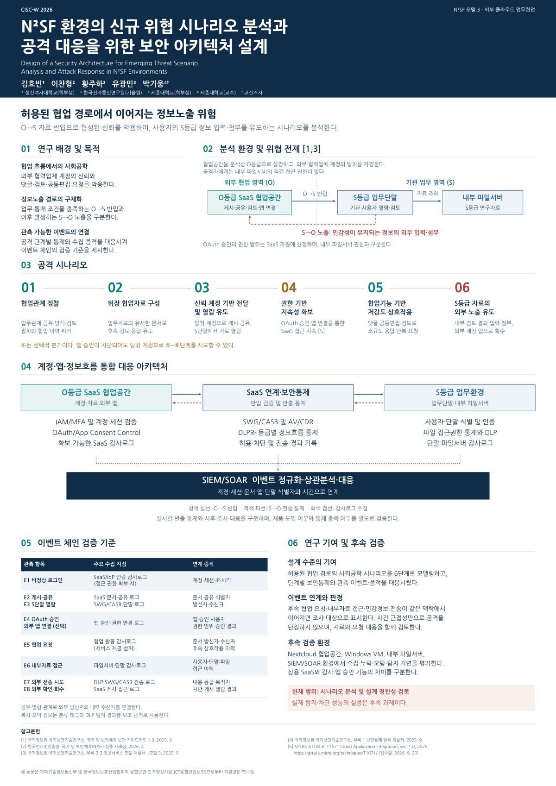

# N2SF 환경의 신규 위협 시나리오 분석과 공격 대응을 위한 보안 아키텍처 설계

2026년 한국정보보호학회 동계학술대회 CISC-W’26 / 포스터

저자: 김효빈, 이찬형, 황주하, 유광민, 박기웅

## 연구 내용

외부 SaaS 협업에서 중요정보가 노출되는 경로를 모델링하고, 단계별 통제 지점과 관측 기준을 제시합니다.

## 자료

- [논문 원문 (PDF)](paper.pdf)
- [학회 발표 자료 (PDF)](presentation.pdf)

## 자료 안내

논문 원문은 제공된 파일 그대로 수록합니다. 학회 발표 자료는 PDF로 제공하며, PowerPoint 원본으로 받은 자료는 PDF로 변환합니다. 구현 저장소에는 논문 작성 이후의 개발 내용이 포함될 수 있습니다.

[전체 연구와 활동 기록으로 돌아가기](../../README.md)
