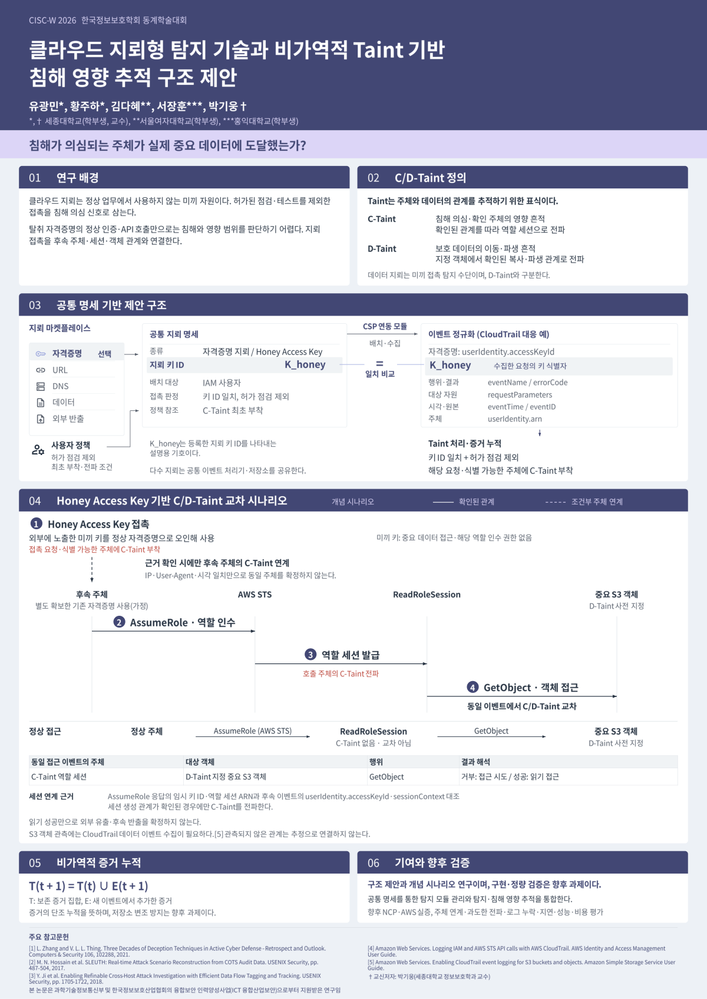

# 클라우드 지뢰형 탐지 기술과 비가역적 Taint 기반 침해 영향 추적 구조 제안

2026년 한국정보보호학회 동계학술대회 CISC-W’26 / 포스터

저자: 유광민, 황주하, 김다혜, 서장훈, 박기웅

## 연구 내용

클라우드 지뢰의 접촉 신호와 중요정보의 이동 흔적을 구분해 추적하고, 두 표식이 교차하는 접근 관계를 식별하는 구조를 제안합니다.

## 자료

- [논문 원문 (PDF)](paper.pdf)
- [학회 발표 자료 (PDF)](presentation.pdf)
- [구현 저장소](https://github.com/ICT-Zero-Cloud/taint-analysis)

## 자료 안내

논문 원문은 제공된 파일 그대로 수록합니다. 학회 발표 자료는 PDF로 제공하며, PowerPoint 원본으로 받은 자료는 PDF로 변환합니다. 구현 저장소에는 논문 작성 이후의 개발 내용이 포함될 수 있습니다.

[전체 연구와 활동 기록으로 돌아가기](../../README.md)
