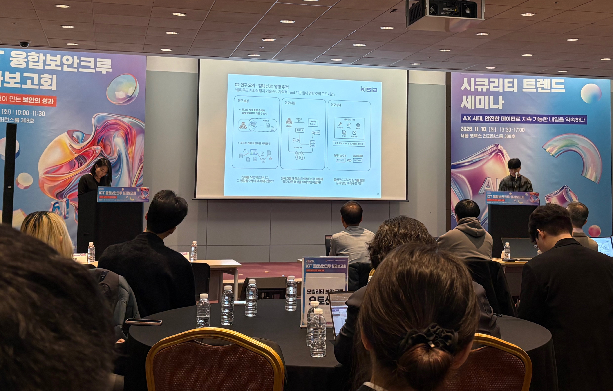
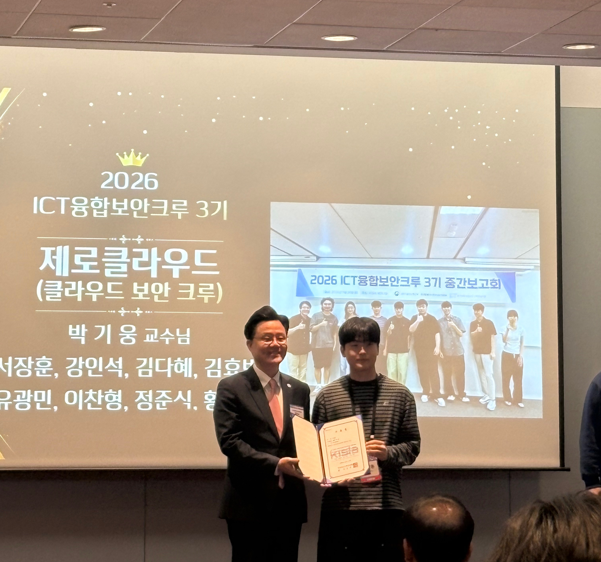
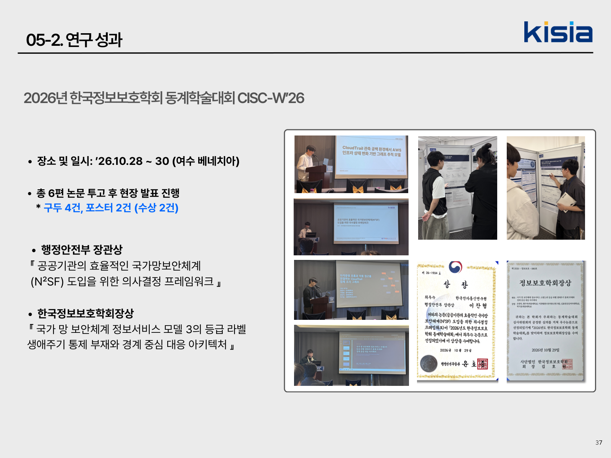
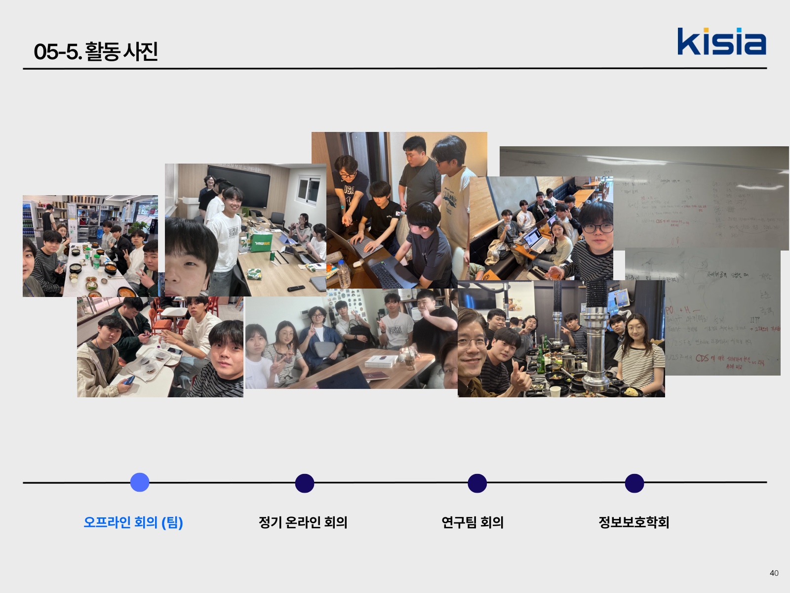
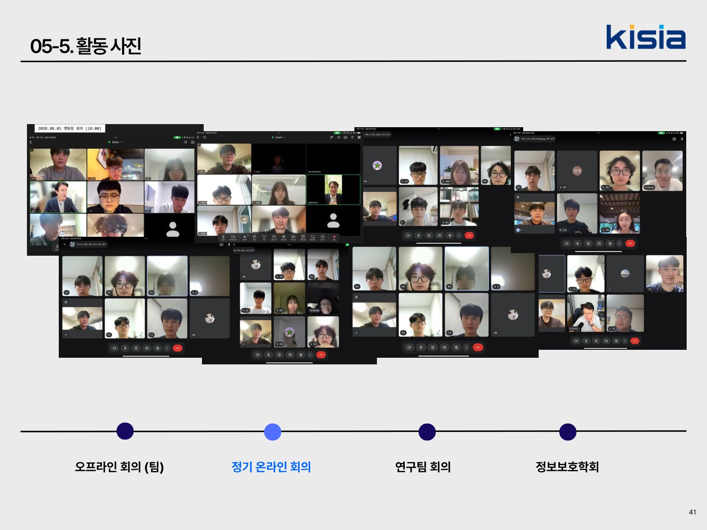
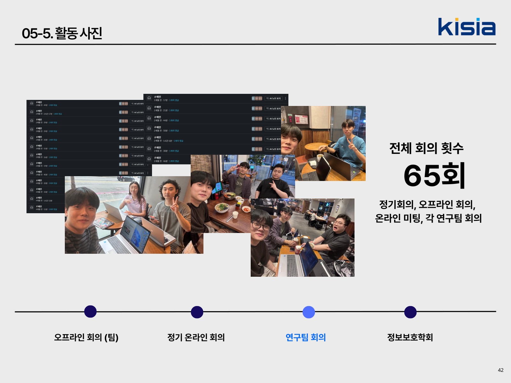
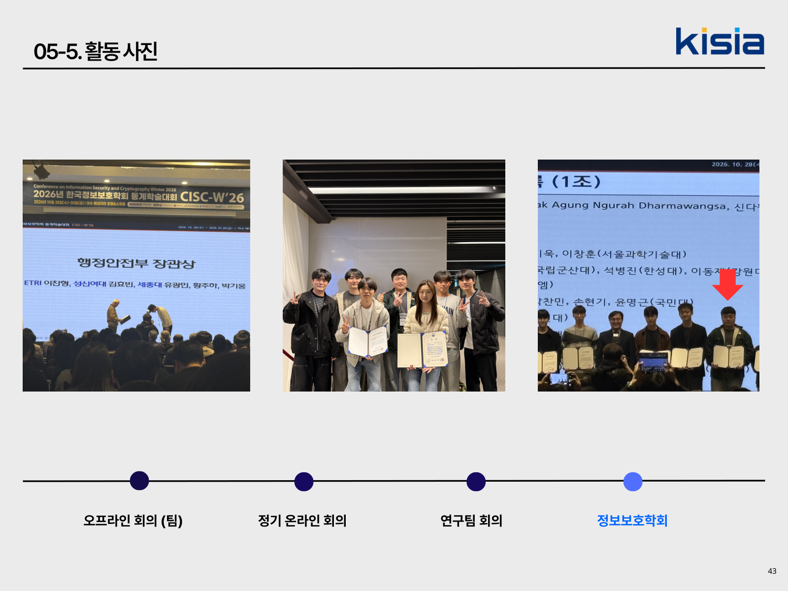

# 성과보고회와 활동 기록

KISIA ICT융합보안크루 3기 제로클라우드의 연구 성과와 활동을 정리합니다.

## 성과보고회

[성과보고회 발표 자료 (PDF)](final-presentation.pdf)

세 연구의 배경부터 연구 내용, 검증과 결론까지 함께 정리한 발표 자료입니다. Q&A까지의 본 발표를 담고, 부록에 있던 개별 논문의 발표 자료는 메인 화면의 연구 자료에서 각각 제공합니다.

2026.11.10 ICT융합보안크루 3기 성과보고회 연구 발표

## 수상

- 2026.11.10 한국정보보호산업협회 ICT 융합보안 우수크루상 (제로클라우드 팀)
- 2026.10.29 행정안전부 장관상 (N²SF 도입 의사결정 프레임워크 논문)
- 2026.10.29 한국정보보호학회장상 (N2SF 모델3 등급 라벨 생애주기 통제 논문)

2026.11.10 한국정보보호산업협회 ICT 융합보안 우수크루상 수상

## 학회 발표

2026년 한국정보보호학회 동계학술대회 CISC-W’26에서 논문 6편을 발표했습니다. 구두발표 4건과 포스터 발표 2건이며, 이 가운데 2편이 수상했습니다.

학회 발표와 수상 사진 보기

## 팀 활동

- 약 6개월간 공동 연구, 연구회의 65회
- 보안 교육 6건 수료, 자격증 5건 취득
- 외부 활동 6건 참여
- ICT융합보안크루 3기 성과보고회 발표

연구와 학회 활동 사진 보기

### 오프라인 팀 회의

### 정기 온라인 회의

### 연구팀별 협업

### 학회 시상과 단체 사진

## 함께한 사람들

서장훈, 강인석, 김다혜, 김효빈, 유광민, 이찬형, 정준식, 황주하 
연구 지도: 박기웅 교수

## 발표 자료 안내

성과보고회 공개본은 43쪽입니다. 원본의 45쪽부터 시작하는 부록과 개인 식별 정보가 담긴 교육 및 자격증 증빙 1쪽을 제외했습니다. 논문별 발표 자료는 별도 PDF로 제공합니다.

[전체 연구와 활동 기록으로 돌아가기](../README.md)
